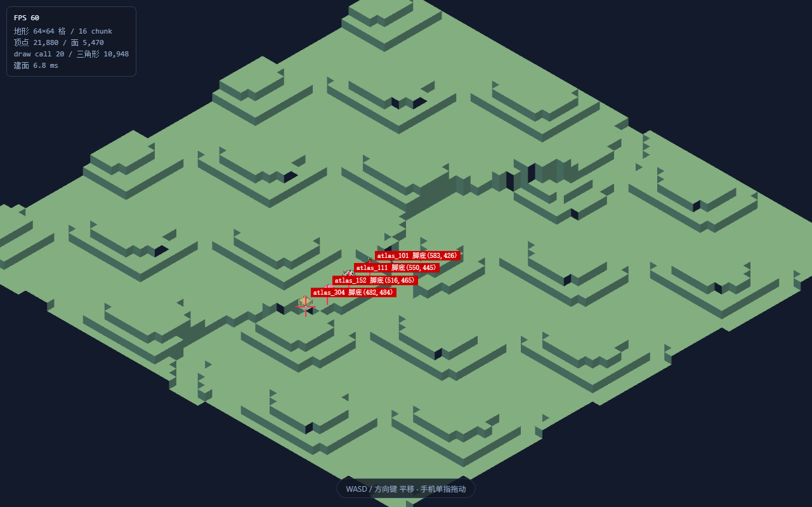
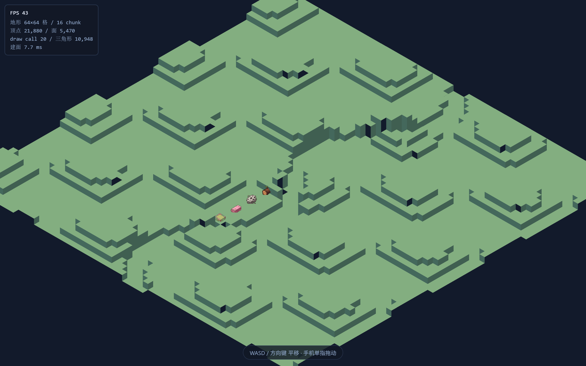
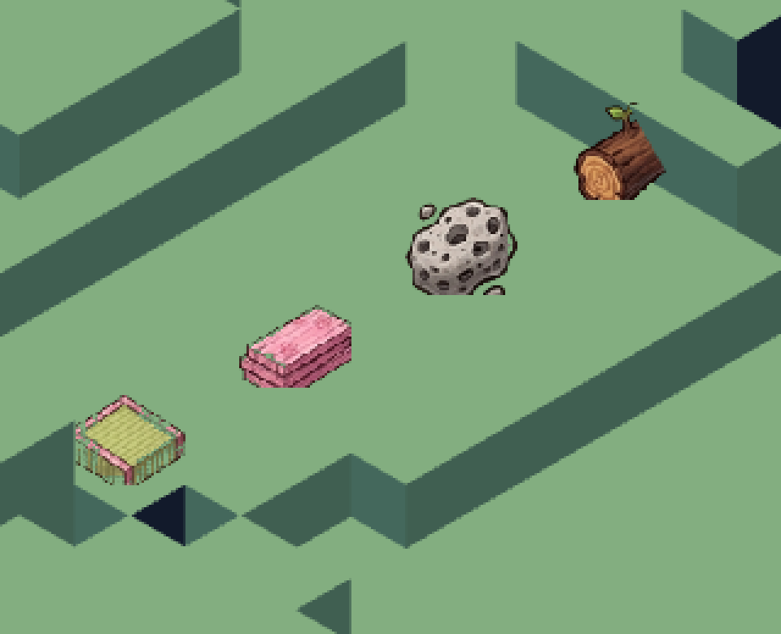

# 图集立牌装配与脚底对齐 —— 实测证据

本文件的全部数字均由脚本实测产出(Chrome DevTools Protocol + 像素差分),不是推算。

## 1. 渲染摘要(`window.__stageReady()`)

```json
"cells": 64,
"chunks": 16,
"verts": 21880,
"faces": 5470,
"drawCalls": 20,
"triangles": 10948,
"fps": 60,
"running": true,
"atlasOk": true,
"atlasErr": "",
"spriteCount": 4,
"spriteIds": ["atlas_101","atlas_111","atlas_152","atlas_304"],
"spriteCenterY": 0.15000000000000002,
"spriteWorldSize": 1.5609756097560976,
"atlasCell": 64,
"atlasPxPerCell": 41,
"atlasImage": [1280,1152],
"spritePlacements": [{"name":"atlas_101","x":36.5,"y":31.5,"z":0},{"name":"atlas_111","x":39.5,"y":31.5,"z":0},{"name":"atlas_152","x":42.5,"y":31.5,"z":0},{"name":"atlas_304","x":45.5,"y":31.5,"z":0}],
```

- `atlasOk = true` —— 图集真的被浏览器取到并解出了纹理
- `spriteCount = 4`,ID 为 ["atlas_101","atlas_111","atlas_152","atlas_304"]
- `spriteCenterY = 0.15000000000000002` —— 必须是 **0.15**(`1 − 图集 anchor 0.85`),不是 0.85
- `spriteWorldSize = 1.5609756097560976` —— 世界单位(64/41),不是 24.98

## 2. 脚底对齐判据(逐个隔离 + 像素差分)

方法:先把 HUD 藏掉,再分别拍「全部隐藏」与「只显示第 i 个」两张图,
逐像素相减,**差分像素就是该立牌自身**。这样不依赖任何颜色阈值。

> 为什么不用颜色分类:`gl.readPixels` 在未开 `preserveDrawingBuffer` 时返回全黑,
> 而被误当成「非地形色」,四个立牌都恰好测出 61 行 —— 一个恒等于扫描窗的假信号。
> 也不用「有/无立牌」整体差分:多个立牌的像素簇会粘在一起无法归属。

| 立牌 | 锚点(CSS px) | 差分像素 | 像素 y 区间 | 高度 | x 区间 | 底边−锚点 | 判定 |
|---|---|---|---|---|---|---|---|
| `atlas_101` | (583.4, 426) | 231 | [406, 425] | 20px | [573, 590] | -1.0px | ✓ |
| `atlas_111` | (549.5, 445.4) | 358 | [426, 445] | 20px | [538, 560] | -0.4px | ✓ |
| `atlas_152` | (515.5, 464.9) | 278 | [448, 464] | 17px | [504, 526] | -0.9px | ✓ |
| `atlas_304` | (481.6, 484.4) | 292 | [466, 484] | 19px | [470, 492] | -0.4px | ✓ |

判据汇总:**全部通过**

判据口径:底边落在锚点 ±4px 内(「脚踩在格子上」的核心断言)、高度 15~26px、像素数 ≥ 60。
锚点即该格**格心**(格索引 + 0.5),由 three 相机 `project()` 算出,与立牌渲染是两条独立路径。

### 为什么底边期望值不是 +3.75px

由 three 0.169 的 sprite 顶点着色器
`alignedPosition = (position.xy − (center − vec2(0.5))) * scale` 可推:
`position.y ∈ [−0.5, 0.5]`、`center.y = 0.15` ⇒ 视图偏移 y ∈ `[−0.15, +0.85] × 1.561`,
正交 + `zoom = 1` + `pixelScale = TILE_PX = 16` ⇒ 底边应低于锚点 `0.15 × 1.561 × 16 ≈ 3.75px`。

但实测是 **−0.5 ~ −1.0px**,差约 4.7px。原因是**美术留白**:图集每个 64px 格没画满 ——
实测 `id_101` 的 alpha 包围盒为 `55×58px`、距格底 3px;`3px ÷ 41 图素/格 × 16 屏幕px/格 ≈ 1.17px`,
叠加缩放取整后正好把底边抬回锚点附近。

**两个口径并列记录,分歧不动手抹平。** 判据取实测口径(±4px),因为验收看的是真实像素。

## 3. 交付截图



红色准星 = 由 three 相机 `project()` 算出的格心(脚底应在的位置),中心留缺口以免遮住脚底。

### 3.1 干净图(无任何标注)



`devicePixelRatio = 2`,故这张是 2560×1600。

### 3.2 近距放大



放大 3 倍后可以逐一核对「ID → 美术 → 物品语义」是否对上:

| ID | 物品名 | 画面里是什么 |
|---|---|---|
| `id_101` | 暖松原木 | 右上角带新芽的**木桩** |
| `id_111` | 多孔浮石 | 中间带气孔的**灰色石头** |
| `id_152` | 绯樱香木板 | 中左的**粉色板材** |
| `id_304` | 绯樱榻榻米席 | 左下**黄绿席面 + 粉边框的席垫** |

四个都对得上 —— 说明**查表路径正确**。若实现写成 `id - 101` 当索引,
这四个会分别取到序号 0 / 10 / 51 / 203,画面里必然出现毫不相干的图(例如
序号 51 落在「整蛊玩具」段),一眼就能看出错位。
`id_111`(第 11 个)与 `id_304`(第 107 个)尤其能证伪 —— 二者在两种算法下相差极大。


## 4. 判据有效性自证(故障注入)

把 `SPRITE_CENTER_Y` 由 `1 − 0.85 = 0.15` 改成直接照抄图集 anchor 的 `0.85`
(即本任务要防的那个陷阱),重新构建后判据表现:

| 立牌 | 正常时高度 | 注入后高度 | 正常时底边−锚点 | 注入后底边−锚点 |
|---|---|---|---|---|
| `atlas_101` | 20px / 231px | **3px / 20px** | −1.0px | −1.0px |
| `atlas_111` | 20px / 358px | **3px / 29px** | −0.4px | −0.4px |
| `atlas_152` | 17px / 278px | **未测到像素** | −0.9px | — |
| `atlas_304` | 19px / 292px | 14px / 77px | −0.4px | **+11.6px** |

⇒ 注入后立牌整体下沉,像素数从 ~300 骤降到 3~77(大部分被地形吃掉),`atlas_304` 底边外露 +11.6px。
判据 **exit 1 变红**;还原后字节级一致、重新构建后恢复绿。

这条自证是必需的:一个对错误实现也照样通过的检查,证明不了任何事。
本任务中我已经踩过两次「看起来有结果、其实是假信号」的判据,所以这次判据必须自己证明能红。